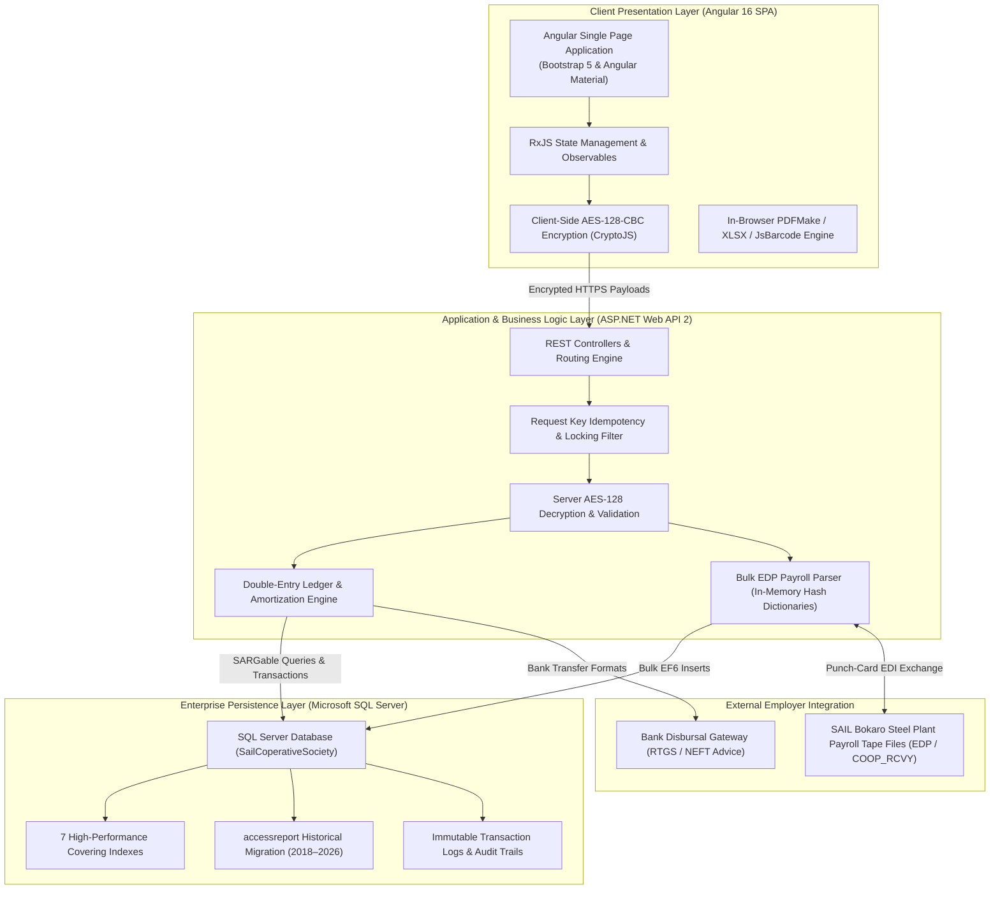

<div align="center">

# Bokaro Steel Employees Co-operative Credit Society System
### Enterprise Core Banking, Loan Origination & Double-Entry Financial Accounting ERP

[](https://angular.io/)
[](https://www.typescriptlang.org/)
[](https://getbootstrap.com/)
[](https://dotnet.microsoft.com/)
[](https://www.microsoft.com/sql-server)
[](#defense-in-depth-security--data-integrity)
[](#)

<p align="center">
  <strong>Mission-critical web enterprise system engineered for the Bokaro Steel Employees (TA/Med./Mat.) Co-operative Credit Society Limited (SAIL - Steel Authority of India Limited).</strong>
</p>

<p align="center">
  <a href="#key-enterprise-capabilities">Key Features</a> •
  <a href="#system-architecture">System Architecture</a> •
  <a href="#core-business-modules">Core Modules</a> •
  <a href="#technology-stack">Tech Stack</a> •
  <a href="#installation--getting-started">Installation</a> •
  <a href="#security--data-integrity">Security</a> •
  <a href="#database--performance-engineering">Performance</a>
</p>

---

</div>

## Executive Summary

The **Bokaro Steel Employees Co-operative Credit Society System** is a mission-critical, enterprise-grade Core Banking and Financial ERP. It was architected to replace legacy Microsoft Access (`.accdb`) desktop workflows with a unified, high-concurrency 3-tier web platform.

Operating at the heart of the **Steel Authority of India Limited (SAIL)** employee cooperative ecosystem in Bokaro Steel City, the platform automates end-to-end credit operations, statutory double-entry financial accounting, multi-guarantor loan underwriting, real-time digital passbooks, and high-throughput payroll deduction tape reconciliation (EDP).

```
   ┌─────────────────────────────────────────────────────────────────────────────┐
   │             Bokaro Steel Employees Co-operative Credit Society Ltd.          │
   ├─────────────────────────────────────────────────────────────────────────────┤
   │  ✓ 10,000+ Registered Steel Plant Members   ✓ Real-Time 4-Stream Passbook   │
   │  ✓ Automated 84-Month Amortization Engine    ✓ Dual Maker-Checker Workflow   │
   │  ✓ SAIL Employer Payroll Tape Reconciliation │ ✓ End-to-End AES-128 Security │
   └─────────────────────────────────────────────────────────────────────────────┘
```

---

## Key Enterprise Capabilities

- 🏛️ **Loan Origination & Underwriting Engine**: Real-time loanee debt calculations, share capital checks, statutory 84-month amortization, and automated equal guarantor distribution with exact remainder resolution.
- ⚖️ **Double-Entry Financial Accounting Core**: Full voucher lifecycle covering Receipt (`R-`), Payment (`P-`), Contra (`C-`), and Transfer (`T-`) vouchers with Maker-Checker dual authorization and immutable audit trails.
- 📑 **SAIL Employer Payroll Integration (EDP Engines)**: Automated processing of employer payroll deduction tapes (`EDP-P17`, `EDP-S05`, `EDP-S06`), bulk batch ingestion processing 1,000+ line items in under 2 database roundtrips.
- 💳 **Member Services & 4-Stream Digital Passbook**: Multi-account ledger tracking Compulsory Deposit (CD), Loan Principal, Interest Accrual, and Share Capital with instant PDF/Excel generation.
- 🏦 **Automated Disbursal & Banking Gateway**: One-click generation of bank-formatted RTGS / NEFT advice and same-bank transfer schedules.
- 🛡️ **Zero-Trust Security & Request Idempotency**: Client-side AES-128-CBC encrypted payloads, UUID request keys preventing duplicate financial submissions, and role-based access control (RBAC).
- ⚡ **High-Performance Architecture**: Seven SQL covering indexes, SARGable date queries, bulk memory maps, and zero-allocation Entity Framework change tracking.

---

## System Architecture

The solution implements an enterprise **3-Tier Distributed Architecture** delivering high availability, deterministic performance, and absolute audit compliance:



---

## Core Business Modules

### 1. Loan Origination & Multi-Guarantor Underwriting (`/admin/loan-application`)
- **Real-Time Loanee Eligibility Evaluation**: Instant auto-fill of member bio-data, current Share Balance (`Head 95 / 083`), and outstanding Loan Debt (`Head 60 / 053`).
- **Surety Division Engine**: Automated validation of guarantors ensuring members do not cross statutory surety limits (*For this member* vs *For others*). Even integer division across guarantors with remainder automatically assigned to the final guarantor.
- **Financial Year-Scoped Sequence**: Application numbers automatically reset to `1` on April 1st of every fiscal year (`FY-YYYY-NNNN`).
- **Dynamic Amortization**: Tenor selection capped at 84 months with real-time monthly EMI, interest, and principal computation.
- **Disbursal Account Verification**: Verification of loanee bank details and IFSC routing codes.

### 2. Double-Entry Voucher & Transaction Management
- **Receipt Vouchers (`/admin/receipt`)**: Inward member and head receipts with automated `R-` transaction sequencing, idempotent submit locking, and soft deletion.
- **Payment Vouchers (`/admin/payment`)**: Outward voucher creation with double-submit protection, cryptographic request keys, and transactional atomicity.
- **Contra & Transfer Vouchers (`/admin/contra`, `/admin/transfer`)**: Seamless handling of bank-to-cash, cash-to-bank, and journal transfer entries.
- **Dual-Control Maker-Checker Audit (`/admin/verify-transactions`)**: Multi-level authorization workflow where cashier entries require supervisory verification before final ledger commitment.

### 3. SAIL Employer Payroll EDI Integration (EDP Engines)
- **EDP-P17 (Master Changes Advice)**: High-speed ingestion of employer recovery files and employee master modifications.
- **EDP-S05 & EDP-S06 (Deduction & Recovery Advices)**: Direct parsing of monthly employer payroll punch-card exports (`COOP_RCVY`).
- **Hybrid Tiered Configuration**: Zero-latency runtime fallback protecting external employer protocol codes (`005`, `05`, `000048`, `09`) against accidental database misconfigurations.
- **N+1 Optimization**: Elimination of row-by-row queries via bulk memory hash lookups, executing 1,000+ line batch items in 2 database calls.

### 4. Member Services & Digital Passbook (`/admin/member-passbook`)
- **Member Master Directory**: Complete 360° member records including department, designation, retirement date, bank details, and nominee information.
- **4-Stream Real-Time Passbook**: Concurrent ledger breakdown displaying monthly transactions across:
  - Compulsory Deposit (CD)
  - Loan Principal & Running Balance
  - Interest Accruals
  - Share Capital
- **Member Document Vault (`/admin/member-doc`)**: Integrated KYC and signed loan agreement document management.

### 5. Statutory Financial Accounting & Reporting
- **Day Book & Cash / Bank Registers**: Daily transactional journal entries with instantaneous cash-in-hand and bank balances.
- **General & Member Sub-Ledgers**: Multi-level account statements with opening balances and running debit/credit totals.
- **Trial Balance & Receipts/Expenditures**: Automated balance validation across all financial heads.
- **Historical Data Bridge**: Fully reconciled migration covering over 18,000 historical records from legacy Access databases (2018–2026).

---

## Technology Stack

| Layer | Technology | Version | Purpose & Architectural Role |
| :--- | :--- | :--- | :--- |
| **Frontend Framework** | **Angular** | `16.2.14` | Reactive Single Page Application (SPA), Component Architecture |
| **Language** | **TypeScript** | `5.1.3` | Type-safe enterprise application logic |
| **UI Components** | **Angular Material** | `16.2.14` | Enterprise data tables, dialogs, form controls, date pickers |
| **Styling & Grid** | **Bootstrap** | `5.3.x` | Responsive grid, utility classes, and layout scaffolding |
| **State & Reactivity** | **RxJS** | `7.8.0` | Asynchronous streams, reactive form bindings, BehaviorSubjects |
| **Client Cryptography** | **CryptoJS** | `4.1.1` | Client-side AES-128-CBC encryption for sensitive API payloads |
| **Document Generation** | **pdfmake / jsPDF** | `0.2.18` / `2.5.1` | Client-side pixel-perfect A4 voucher, passbook & advice generation |
| **Data Export** | **xlsx / FileSaver** | `0.18.5` / `2.0.5` | Excel report streaming and payroll schedule generation |
| **Barcode & Utility** | **JsBarcode / bwip-js** | `3.11.6` / `4.5.1` | Barcode rendering on physical membership cards and loan slips |
| **Backend Framework** | **ASP.NET Web API 2** | `.NET 4.6.1` | High-throughput REST API controllers & business logic |
| **ORM / Data Access** | **Entity Framework 6** | `6.4.4` | Relational data mapping, SARGable LINQ, ADO.NET execution |
| **Database** | **Microsoft SQL Server** | `2019 / 2022` | ACID relational database with covering indexes and schema separation |

---

## Repository & Project Structure

```
SailCooperatuveSociety/
├── SailUserInterface/                # Angular 16 Enterprise Frontend
│   ├── src/
│   │   ├── app/
│   │   │   ├── admin/                # Feature Modules
│   │   │   │   ├── loan-application/ # Loan underwriting & surety allocation
│   │   │   │   ├── receipt/          # Inward receipt vouchers & sequences
│   │   │   │   ├── payment/          # Outward payment vouchers & request keys
│   │   │   │   ├── member-passbook/  # 4-Stream digital member passbook
│   │   │   │   ├── edp-p17/          # SAIL employer payroll tape advice
│   │   │   │   ├── edp-s05/          # Recovery deduction batch processing
│   │   │   │   ├── edp-s06/          # Loan master adjustments advice
│   │   │   │   ├── verify-transactions/ # Maker-Checker verification pipeline
│   │   │   │   ├── accounting/       # Historical ledger & Access reports
│   │   │   │   ├── member/           # Member KYC & directory management
│   │   │   │   └── company/          # Hybrid tiered company settings
│   │   │   ├── utils/                # Core Services & Cross-Cutting Concerns
│   │   │   │   ├── app.service.ts    # Centralized HTTP gateway with interceptors
│   │   │   │   ├── local.service.ts  # AES-128-CBC client encryption engine
│   │   │   │   └── company-settings.service.ts # Reactive settings with fallback
│   │   │   └── material/             # Shared Angular Material module
│   │   ├── assets/                   # Static branding, logos, and stylesheets
│   │   └── index.html                # Application root entry point
│   ├── angular.json                  # Angular CLI build & workspace configuration
│   └── package.json                  # Frontend dependencies and npm scripts
│
├── Api/                              # ASP.NET Web API 2 Backend Solution
│   ├── Project/                      # Entity Framework 6 EDMX & Database Models
│   ├── ProjectAPI/                   # REST API Controllers, Crypto & Business Engine
│   │   ├── Controllers/api/          # API Endpoints (Loan, Payment, Receipt, EDP)
│   │   ├── Accounting/               # Double-entry posting engine & SQL migrations
│   │   ├── Models/                   # Data transfer objects (DTOs) & view models
│   │   └── Web.config                # Database connections & environment config
│   └── ProjectAPI.sln                # Visual Studio Solution File
│
└── files/                            # Architectural Specs, Manuals & SQL Scripts
    ├── Documentation/                # In-depth architectural & performance whitepapers
    └── Loan_Application_System_README.md # Complete loan subsystem specification
```

---

## Defense-in-Depth Security & Data Integrity

```
[ Angular 16 Client ]
       │
       ▼  1. Encrypt Payload with AES-128-CBC (Shared Secret + Dynamic IV)
       ▼  2. Attach Cryptographic UUID RequestKey to Prevent Double-Submission
[ HTTPS / TLS 1.3 ]
       │
       ▼
[ ASP.NET Web API 2 ]
       │
       ▼  3. Verify RequestKey in Transaction Cache (Reject Duplicates with 409 Conflict)
       ▼  4. Server-Side Decryption & Strict Regex Format Validation
       ▼  5. Role-Based Access Control (RBAC) Verification (SuperAdmin / Admin / Staff)
       ▼
[ SQL Server Database ]
       │
       ▼  6. Begin Atomic Database Transaction
       ▼  7. Sequential ID Generation (R-, P-, C-, T- Sequences)
       ▼  8. Non-Destructive Soft-Delete Audit Trail (IsDeleted = 0, ModifiedOn = UTC)
       ▼  9. Commit Transaction
```

1. **Payload Encryption (AES-128-CBC)**: All sensitive financial requests sent between the Angular client and ASP.NET Web API are encrypted on the client side using `CryptoJS` and decrypted via .NET `RijndaelManaged` cryptography.
2. **Transaction Idempotency**: Financial requests (Receipts, Payments) require a unique client-generated UUID `RequestKey`. Identical retries return cached transaction results, preventing accidental double-charging.
3. **Dual Maker-Checker Authorization**: Critical vouchers submitted by cashiers remain in unverified state until approved by an administrator via `/admin/verify-transactions`.
4. **Non-Destructive Auditing**: Physical database deletions are prohibited across transactional tables. Records utilize soft deletion flags (`IsDeleted = 1`) with automatic audit trails (`CreatedBy`, `CreatedOn`, `ModifiedBy`, `ModifiedOn`).

---

## Database & Performance Engineering

To handle high-frequency concurrent operations during monthly payroll processing, the database was optimized with a two-tier optimization architecture:

### 1. Covering Index Matrix
| Target Table | Index Name | Type | Performance Improvement |
| :--- | :--- | :--- | :--- |
| `dbo.Member` | `IX_Member_StaffNo_Status` | Non-Clustered Covering | Full table scan eliminated $\rightarrow$ $O(1)$ index seek |
| `dbo.Member` | `IX_Member_MemberNo_Status` | Non-Clustered Covering | Instantaneous member lookup across 10,000+ members |
| `dbo.LoanApplication` | `IX_LoanApplication_VerifiedDate_Deleted` | Non-Clustered Covering | Sub-millisecond loan date-range reporting |
| `dbo.EDPAdviceLine` | `IX_EDPAdviceLine_Batch_Deleted` | Non-Clustered Covering | Accelerated batch advice retrieval |
| `dbo.Payment` | `IX_Payment_PaymentDate` | Non-Clustered Covering | Instant register aggregation and cash-flow summaries |
| `dbo.VoucherLine` | `IX_VoucherLine_Head_Deleted` | Non-Clustered Covering | Rapid general ledger joins & trial balance calculation |
| `dbo.Voucher` | `IX_Voucher_Date_Status` | Non-Clustered Covering | High-speed date-filtered voucher lookups |

### 2. High-Throughput Batch Processing
- **N+1 Elimination in EDP Engines**: Replaced row-by-row queries in the 1,000-line payroll advice loop with bulk in-memory hash dictionaries (`memberMap` and `identityMap`), reducing database roundtrips from over 2,000 down to **2**.
- **SARGable Half-Open Range Filters**: Refactored SQL queries to use index-seekable half-open ranges (`>= @FromDate AND < @ToDateNext`), eliminating CPU-expensive `CAST(ISNULL())` function evaluations.
- **Zero-Allocation Change Tracking**: High-throughput read endpoints utilize `.AsNoTracking()` to avoid Entity Framework change-tracker memory overhead.

---

## Installation & Getting Started

### Prerequisites

Ensure the following environments are installed on your workstation or server:

- **Node.js**: `v18.x` or `v20.x` LTS
- **Angular CLI**: `v16.1.0` or higher (`npm install -g @angular/cli@16`)
- **.NET Framework**: `v4.6.1` Developer Pack or Visual Studio 2019/2022
- **Database**: Microsoft SQL Server 2016+ (or SQL Server Express)
- **Web Server (Optional)**: IIS 10 with URL Rewrite Module

---

### Step 1: Clone the Repository

```bash
git clone https://github.com/mozakkirkhan01/web-based-Cooperative-Society-Management-System.git
cd web-based-Cooperative-Society-Management-System
```

---

### Step 2: Database Configuration

1. Open **SQL Server Management Studio (SSMS)**.
2. Connect to your SQL Server instance (e.g., `.\SQLEXPRESS`).
3. Create the target database:
   ```sql
   CREATE DATABASE SailCoperativeSociety;
   ```
4. Execute the baseline schema and additive migration scripts located in `files/Documentation/` and `Api/ProjectAPI/Accounting/`.
5. Update the connection string in `Api/ProjectAPI/Web.config`:
   ```xml
   <connectionStrings>
     <add name="SailCoperativeSocietyEntities" 
          connectionString="metadata=res://*/...;provider=System.Data.SqlClient;provider connection string=&quot;data source=.\SQLEXPRESS;initial catalog=SailCoperativeSociety;integrated security=True;MultipleActiveResultSets=True;App=EntityFramework&quot;" 
          providerName="System.Data.EntityClient" />
   </connectionStrings>
   ```

---

### Step 3: Backend API Setup

Open PowerShell or command prompt:

```powershell
# Using MSBuild to compile the solution
& "C:\Program Files (x86)\Microsoft Visual Studio\2019\Professional\MSBuild\Current\Bin\MSBuild.exe" "Api\ProjectAPI.sln" /t:Build /p:Configuration=Debug /verbosity:minimal

# Or run using the automated startup script:
.\start-backend.ps1
```

The Web API service starts under IIS Express at: `https://localhost:44302/`

---

### Step 4: Frontend UI Setup

Navigate into the frontend directory:

```bash
cd SailUserInterface

# Install dependencies
npm install

# Start development server
npm start
# or: npx ng serve --port 4200
```

Open your browser and navigate to:
```
http://localhost:4200/#/admin-login
```

---

### Step 5: Production Build

To build the optimized, ahead-of-time (AoT) compiled production bundle:

```bash
cd SailUserInterface
npm run build -- --configuration production
```

The compiled assets will be generated in the `dist/sugarandice-ui/` directory, ready to be deployed to **IIS** or **Nginx**.

---

## Production Deployment Checklist

- [x] Configure HTTPS SSL/TLS certificate on IIS / Nginx.
- [x] Enable IIS URL Rewrite module for HTML5 Angular deep-linking (`#` routing fallback).
- [x] Apply SQL Server covering indexes from `Database_Query_Optimization_and_Performance_Architecture_Documentation.md`.
- [x] Verify Tier 2 protocol codes in `dbo.Company` (`SocietyCode3 = '005'`, `SocietyCode2 = '05'`).
- [x] Set environment production flags in `SailUserInterface/src/environments/environment.prod.ts`.
- [x] Establish daily automated SQL Server database backup schedules with transaction log truncation.

---

## UI & Workflow Showcase

<div align="center">

| Module | Interface Description | Key Capabilities |
| :--- | :--- | :--- |
| **Loan Application** | `/admin/loan-application` | Dynamic guarantor search, instant loanee debt calculation, EMI schedule preview |
| **Maker-Checker** | `/admin/verify-transactions` | Dual authorization approval queue for cashier receipts and payment vouchers |
| **Digital Passbook** | `/admin/member-passbook` | 4-stream transaction history, monthly interest calculation, PDF export |
| **EDP Payroll Advice** | `/admin/edp-p17` | High-throughput batch processing of SAIL steel plant payroll tape deductions |
| **Financial Ledger** | `/admin/accounting/access-reports` | Double-entry Day Book, Cash/Bank Books, General Ledger, and Trial Balance |

</div>

---

## Contributors & Governance

Developed and maintained for the **Bokaro Steel Employees (TA/Med./Mat.) Co-operative Credit Society Limited**, Bokaro Steel City, Jharkhand, India.

- **Lead Engineer & Architect**: [Md Mozakkir Khan](https://github.com/mozakkirkhan01)
- **Organization**: SAIL Employees Co-operative Credit Society Limited
- **Project Repository**: [web-based-Cooperative-Society-Management-System](https://github.com/mozakkirkhan01/web-based-Cooperative-Society-Management-System)

---

## License

This software and related documentation are proprietary to the **Bokaro Steel Employees (TA/Med./Mat.) Co-operative Credit Society Limited**. All rights reserved. Unauthorized copying, distribution, modification, or deployment without explicit written permission is strictly prohibited.
